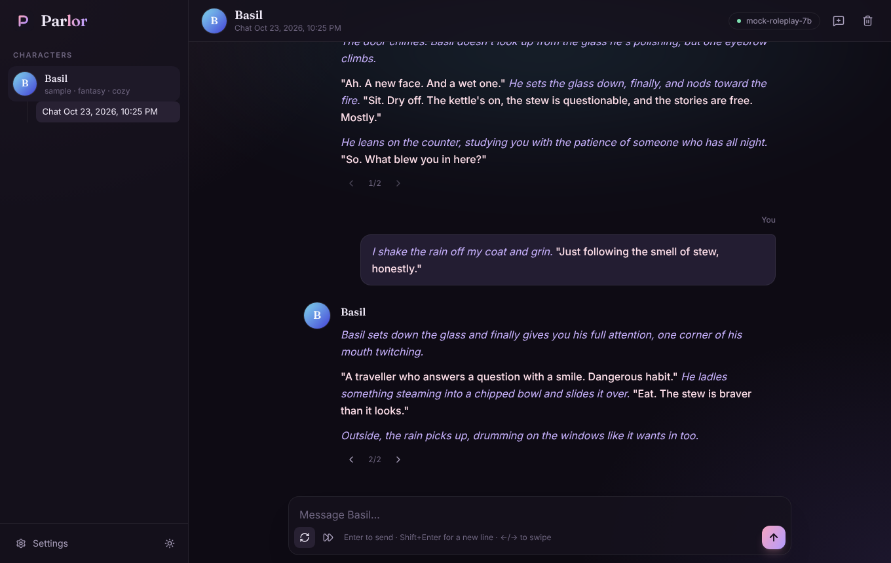
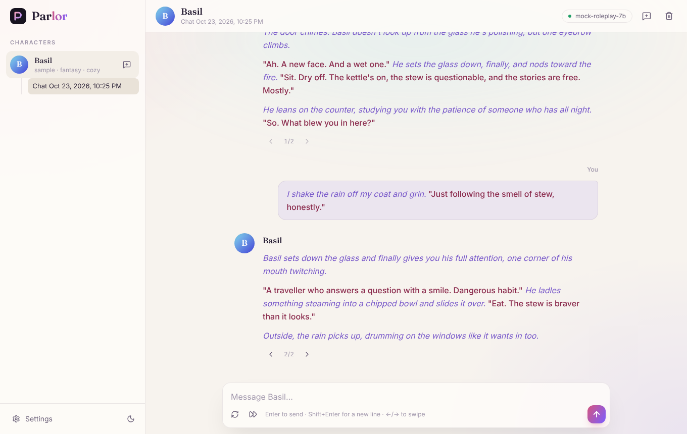
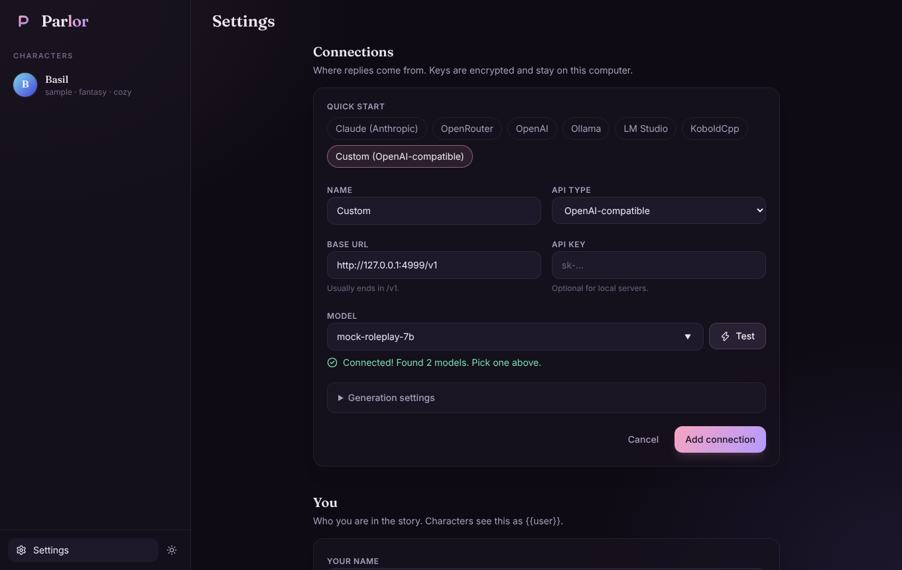

# Parlor 🍝

A pretty, local-first AI roleplay chat frontend, in the spirit of SillyTavern and Marinara Engine. Bring your own model (Claude, OpenRouter, Ollama, LM Studio, KoboldCpp or anything OpenAI-compatible), pull up a chair, and tell a story.



## Quick start

You need Node 22 or newer and pnpm (`corepack enable` gets you pnpm).

```bash
pnpm install
pnpm start        # builds the UI and serves everything on http://127.0.0.1:3700
```

Open the app, go to **Settings → Connections**, pick a quick-start preset, paste a key if it needs one, hit **Test**, choose a model and save. Then say hi to Basil, the sample character.

**On your phone:** run `HOST=0.0.0.0 pnpm start` and open `http://<your-computer's-ip>:3700` on the same Wi-Fi. Only do this on a network you trust; there's no login yet.

### Development

```bash
pnpm dev          # API on :3700 with reload, UI on http://127.0.0.1:5173 with hot reload
pnpm test         # prompt builder, provider adapters and API tests
pnpm typecheck
```

Your data (SQLite database plus the key that encrypts your API keys) lives in `./data`. Set `PARLOR_DATA_DIR` to put it somewhere else. Back it up by copying that folder.

## What works today

- Streaming chats with Claude (native API) and any OpenAI-compatible server
- Swipes: regenerate a reply and flip between versions with the arrows or ←/→
- Continue a reply, stop mid-stream (the partial reply is kept), edit, copy and delete messages
- Alternate greetings show up as swipes on the first message
- Roleplay-aware text styling: *actions* in italics, "speech" highlighted
- Your name and persona, an editable system prompt, `{{char}}` / `{{user}}` macros
- Token-aware trimming so long chats fit the model's context
- API keys encrypted at rest (AES-256-GCM) and never sent back to the browser
- Dark ("Velvet") and light ("Parchment") themes, mobile-friendly layout

<p>
  
  
</p>

### Notes on Claude

Claude's current API doesn't accept temperature or top-p, so Claude connections get an **Effort** setting instead (low is snappy, high thinks harder). Max reply tokens include Claude's thinking, so leave plenty of room (8192 by default). On models that support it, Parlor turns on Anthropic's server-side refusal fallback, so an over-cautious decline is retried on another Claude model instead of failing.

## Roadmap

- [x] **Phase 0: Skeleton.** Monorepo, server, UI, SQLite, settings
- [x] **Phase 1: Talk to a model.** Claude + OpenAI-compatible adapters, streaming, swipes
- [ ] **Phase 2: Characters and personas.** V2/V3 card import/export (PNG + JSON), character editor, avatars, multiple personas
- [ ] **Phase 3: Real RP chat.** Prompt preset editor, prompt inspector, chat search
- [ ] **Phase 4: Lorebooks.** Keyword-triggered world info, embedded card lorebooks
- [ ] **Later:** branching, group chats, regex scripts, summaries and memory, VN mode with sprites, an AI game master

## How it's built

| Part | Tech |
| --- | --- |
| UI | React 19, Vite, Tailwind CSS 4, TanStack Query, React Router |
| Server | Node 22, Hono, SSE streaming |
| Storage | SQLite via libSQL + Drizzle ORM (migrations in `apps/server/drizzle`) |
| Shared | `packages/shared`: types, the prompt builder and macros |

The browser never talks to model APIs directly. It asks the local server to generate, the server builds the prompt (`packages/shared/src/prompt.ts`), calls the provider adapter (`apps/server/src/providers`), and streams tokens back over Server-Sent Events.
